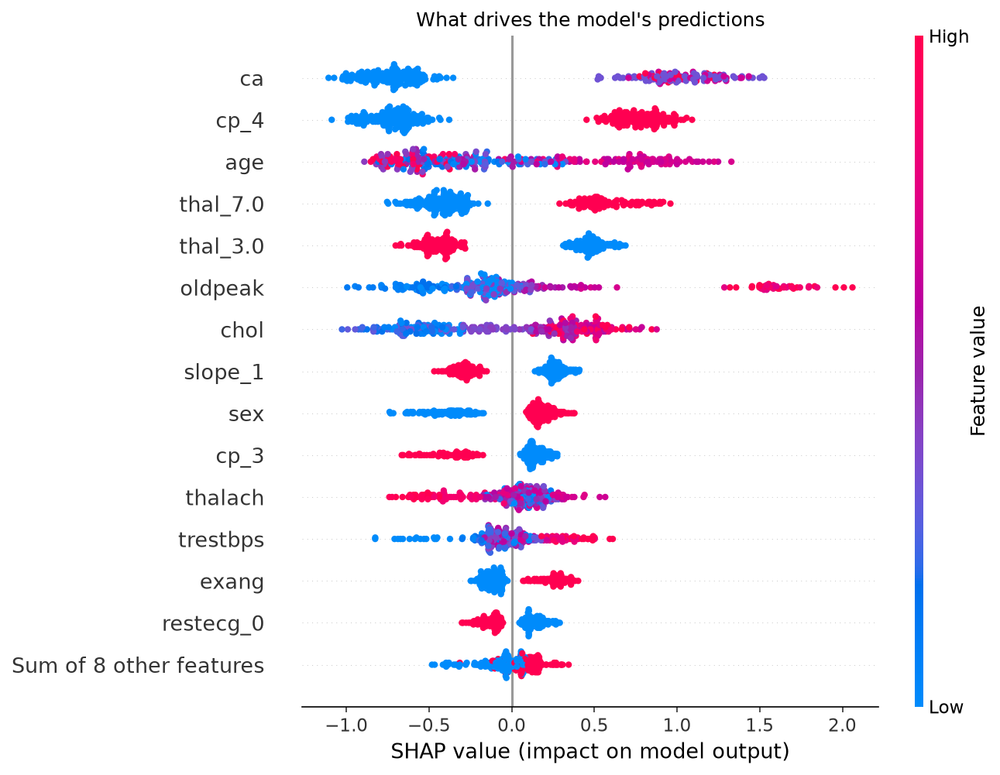
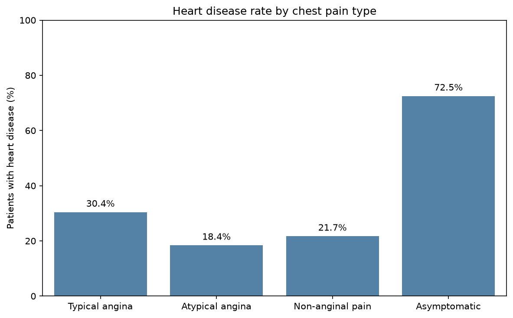
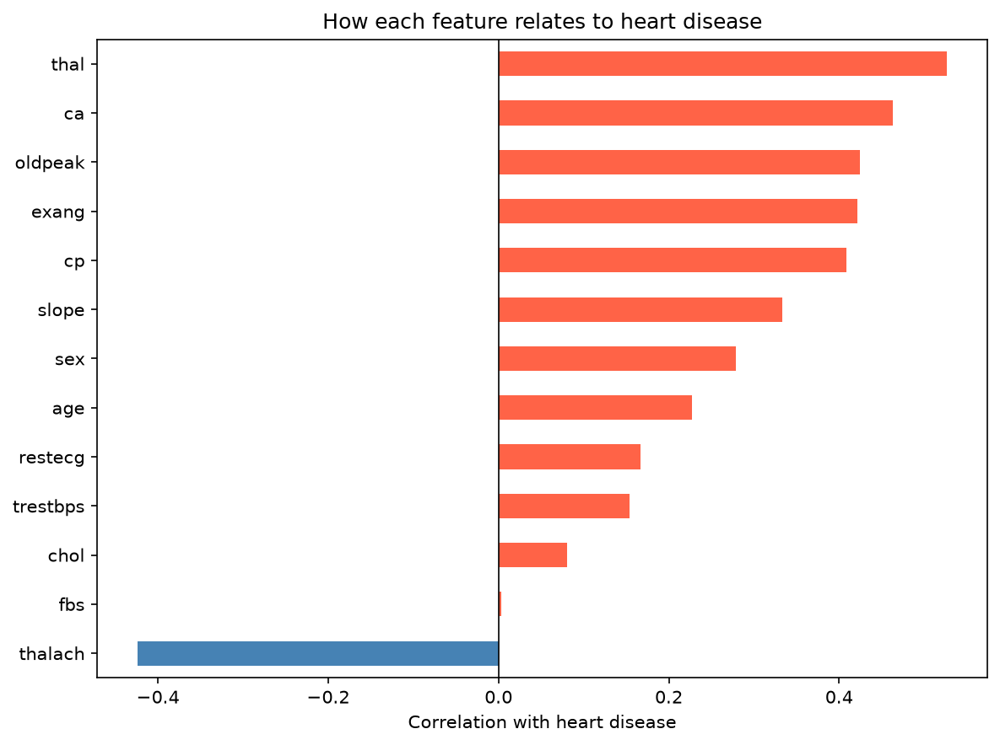

# Heart Disease Risk Predictor

**Live demo: [heart-disease-prediction-fa.streamlit.app](https://heart-disease-prediction-fa.streamlit.app/)**

An end-to-end machine learning project that predicts the risk of heart disease from 13 clinical
measurements, explains every prediction with SHAP, and presents findings from the data in a
Streamlit app backed by PostgreSQL.



## Highlights
- **Data pipeline:** UCI Cleveland heart disease data cleaned in pandas and stored in PostgreSQL.
- **Analysis:** SQL and Python EDA on chest pain type, age, sex, and clinical averages.
- **Modeling:** baseline vs. logistic regression vs. XGBoost, 5-fold cross-validation, held-out test set.
- **Threshold tuning:** the decision cutoff is lowered from 50% to 35% (chosen on training data only)
  because missing a sick patient is worse than a false alarm.
- **Explainability:** SHAP waterfall chart for every prediction, plus error analysis of missed cases.
- **App:** three-page Streamlit app (Predict, Insights, About). Insights charts run live SQL.

## Results

| Measure | Cross-validated (training data) | Held-out test set (60 patients) |
|---|---|---|
| Accuracy | ~81% | 90% |
| Recall (sick patients caught) | ~82% | 89% |
| Precision (flags that were correct) | ~77% | 89% |
| ROC AUC | — | 0.92 |

The test set scores are higher than cross-validation, which suggests an easy test split.
The cross-validated numbers are the more reliable estimate.

## Key findings
- Patients with **no chest pain** had the highest disease rate (72.5%), most likely referral bias:
  everyone in the data was sent for cardiac testing, so those without pain had other warning signs.
- Men had a disease rate of 55.7% vs. 26.0% for women.
- Disease rate rises with age through 64 (63.6% for ages 55-64).
- The strongest predictors are blocked vessels on imaging, asymptomatic chest pain, thalassemia
  results, and ST depression, which match established clinical risk factors.

| | |
|---|---|
|  |  |

## Project structure

```
01_explore_data.ipynb    Load UCI data, clean it, store in PostgreSQL
02_eda.ipynb             SQL insights and charts
03_modeling.ipynb        Baseline, logistic regression, XGBoost, CV, threshold tuning, saved model
04_explain_model.ipynb   SHAP explanations and error analysis
app.py                   Streamlit entry point (navigation)
predict.py               Predict page: patient form, risk score, SHAP waterfall
insights.py              Insights page: live SQL charts
about.py                 About page: methods, results, limitations
db.py                    Database connection: PostgreSQL if configured, else the bundled snapshot
load_to_neon.py          Copies the patients table from local PostgreSQL to Neon
export_snapshot.py       Exports the patients table to app_data/ for the public demo
app_data/                Snapshot of the patients table (297 rows)
models/                  Saved model pipeline and threshold
images/                  Charts used in the app and this README
```

## Run it locally

1. Create a virtual environment and install the app dependencies:
   ```bash
   python -m venv .venv
   .venv\Scripts\activate
   pip install -r requirements.txt
   ```
   The notebooks also use `seaborn`, `ucimlrepo`, and `ipykernel`:
   ```bash
   pip install seaborn ucimlrepo ipykernel
   ```
2. Create a `.env` file with your PostgreSQL connection:
   ```
   DB_USER=postgres
   DB_PASSWORD=your_password
   DB_HOST=localhost
   DB_PORT=5432
   DB_NAME=heart_db
   DB_SSLMODE=disable
   ```
3. Run `01_explore_data.ipynb` once to load the data into PostgreSQL.
4. Start the app:
   ```bash
   streamlit run app.py
   ```

## Deploy (Streamlit Community Cloud)

On [share.streamlit.io](https://share.streamlit.io), create an app from this repo with `app.py` as the
main file and Python 3.13. That's all the public demo needs: with no database configured, the app loads
`app_data/patients.csv` into an in-memory SQLite database and runs the same SQL queries.

To query PostgreSQL in the cloud instead:
1. Add `NEON_USER`, `NEON_PASSWORD`, `NEON_HOST`, and `NEON_DB` to `.env`, then run
   `python load_to_neon.py` to copy the table to Neon.
2. Under the app's **Settings → Secrets**, add the Neon connection:
   ```toml
   DB_USER = "..."
   DB_PASSWORD = "..."
   DB_HOST = "...neon.tech"
   DB_PORT = "5432"
   DB_NAME = "..."
   DB_SSLMODE = "require"
   ```

## Limitations
- Small dataset: 297 patients from a single clinic, collected in the 1980s.
- Referred patients only, so the model is not suited to screening the general public.
- The strongest inputs come from stress tests and imaging, which require a hospital visit.
- Women are underrepresented (about a third of patients), so their predictions are less certain.
- **Not a medical device.** This is an educational project and has not been clinically validated.

## Tech stack
Python, pandas, PostgreSQL, SQLAlchemy, scikit-learn, XGBoost, SHAP, Streamlit, Neon
